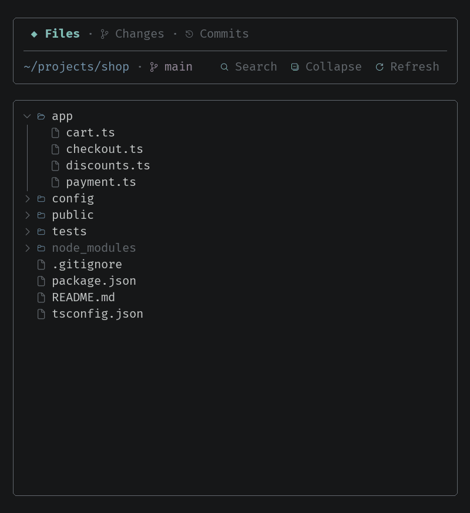

# clawd-git

[](https://github.com/itsomidho/clawd-git/releases)

A live git panel for [Claude Code](https://claude.com/claude-code), docked beside the conversation and styled like [clawd-statusbar](https://github.com/itsomidho/clawd-statusbar). It shows the files, the changes and the commit graph as Claude works, marks the files Claude changed, and lets you stage, commit, and ask Claude to review a diff without leaving the session.



<sub>One session, time-lapsed: Claude edits two files, which show up marked ✦; Changes narrows to Claude's files; a diff opens and goes to Claude for review; both files are staged, a commit message is drafted and committed, and the commit graph shows it.</sub>

## What it shows

| Tab | |
|---|---|
| **Files** | The folder tree on disk, as an editor's sidebar: open a folder, press a file to see its diff (or its text). Git-ignored entries dimmed, changed files colored with their status, folders holding changes marked •. **Search** finds any file by name. |
| **Changes** | The branch and every changed file, grouped (conflicts, staged, unstaged, new), with `+added −removed`. **Diff all** shows every change at once. |
| **Commits** | The commit graph across all branches, one color per lane; press a commit to see its diff. |

A diff opens over the tab it came from; **Back** returns there. The header stays put while the rows scroll (wheel, PageUp/PageDown, Home/End), and anything wider than the panel slides sideways with ◀ ▶.

The panel is drawn like [clawd-debug](https://github.com/itsomidho/clawd-debug)'s pane: a header card with **Git**, the branch as a chip and how the tree stands (or the latest notice), then a key bar; the tabs as pills; and a card with what the tab shows, titled with its name and folder, with a scrollbar. Every key on the bar is always there, dim when it does not apply, and works as soon as the panel has the keyboard (a click, or ctrl+x tab):

| Key | | Key | |
|---|---|---|---|
| `h` | back from a diff | `x` | review the diff, or explain the commit |
| `f` | search, or end the search | `v` | send your review notes |
| `z` | collapse the tree | `m` | draft a commit message |
| `d` | diff all | `o` | open the file in your editor |
| `t` | this turn | `g` | debug the file (with clawd-debug) |
| `b` | Claude's files only, or all | `r` | refresh |

### What Claude changed

- **This turn**: when Claude starts working on your message, the panel takes a snapshot of the working tree. **This turn** in Changes then shows exactly what Claude changed since your last message, new files included, as one diff. (The snapshot is a git tree object written through a copy of the index: your files, your staged changes and your history are left alone.)
- Every file Claude writes this session (with Edit, Write, or a shell command) is marked **✦** in Files and Changes. **By Claude** narrows Changes to those files; a `/clear` starts the list over.

### Reviewing Claude's work

Read a diff as you would a pull request. The **+** beside a line opens a note on it; type what you want changed and press Enter. Notes show under their lines (**✎**) and gather in Changes under **Review notes**. **Send review** gives them to Claude in one message, each with its file, line and code, then clears them.

### Acting on it

| | |
|---|---|
| **+** **−** **↺** on a row | stage, unstage, discard (discard asks first: it cannot be undone) |
| **Stage all** / **Unstage all** | on a group's header |
| **Commit** | drafts a message for what is staged, in the style of your recent commits; then **Commit**, **Again**, **Ask Claude** (hand the draft to Claude to adjust and commit), or **Cancel** |
| **Review** on a diff, **Explain** on a commit | sends Claude a request to review the changes (a file, all of them, or this turn) or explain the commit |
| **Open** on a file's diff | opens the file in your editor at its first changed line |
| **▷** on a file's row, **Debug** on its diff | with clawd-debug loaded, opens a PHP, Python or JavaScript file in its debugger pane, to set breakpoints and step through it (hidden without it) |

## Install

In Claude Code, type:

```
/plugin install clawd-git --marketplace itsomidho/claude-plugins
```

Answer `y` to add the marketplace if asked, then choose a scope. From a shell: `claude plugin install clawd-git --marketplace itsomidho/claude-plugins`.

For Claude's plan as it works, add [clawd-tasks](https://github.com/itsomidho/clawd-tasks) from the same marketplace: it shows the plan under the prompt, while this panel shows the files.

## Use

`/git-pane` shows or hides the panel; `/git-pane files`, `changes`, `commits`, `diff` or `turn` opens it on that tab or view. Click anything in it, or focus it with ctrl+x tab to use its keys. The side pane needs Claude Code's fullscreen layout; on a narrow terminal it waits until there is room.

It refreshes right after each edit or shell command of Claude's. In between it asks git for its status every 2 seconds and reads the rest only when something moved, so a quiet repository costs one `git status` per tick.

## Settings

In `/config`:

| Setting | |
|---|---|
| **Placement** | `side` (default): docked beside the conversation. `prompt`: inside the main screen, above the prompt |
| **Panel height** | rows above the prompt, with Placement `prompt` (16) |
| **Show on start** | show the panel when a session starts |
| **Refresh every** | seconds between status checks (2) |
| **File icons** | `auto` (default) picks by your fonts: with a [Nerd Font](https://www.nerdfonts.com/), `line` (VS Code's Codicons); else `outline` (🗀 🗁 🗋, from Noto Sans Symbols 2) when the fonts have it; else `simple` (colored dots). Or `nerd` for colored file-type icons, or `off`. Nothing draws as boxes |
| **Pane background** | `none` (default) keeps your terminal's background; or a color |
| **Editor** | `auto` tries code, cursor, zed, subl and phpstorm, then the system's opener; or a command with `{file}` and `{line}`, e.g. `code -g {file}:{line}` |

## Development

```
claude plugin validate .
claude plugin test .
python3 docs/demo_gif.py docs/demo.gif   # needs Pillow and FiraCode Nerd Font Mono
```

The hooks live in `hooks/`: `register.tsx` wires them, `data.ts` reads git and the disk, `actions.ts` is what a press does, `pages.tsx` builds each tab, `draw.tsx` draws the frames, `git.ts` and `icons.ts` are pure helpers with their own tests.
